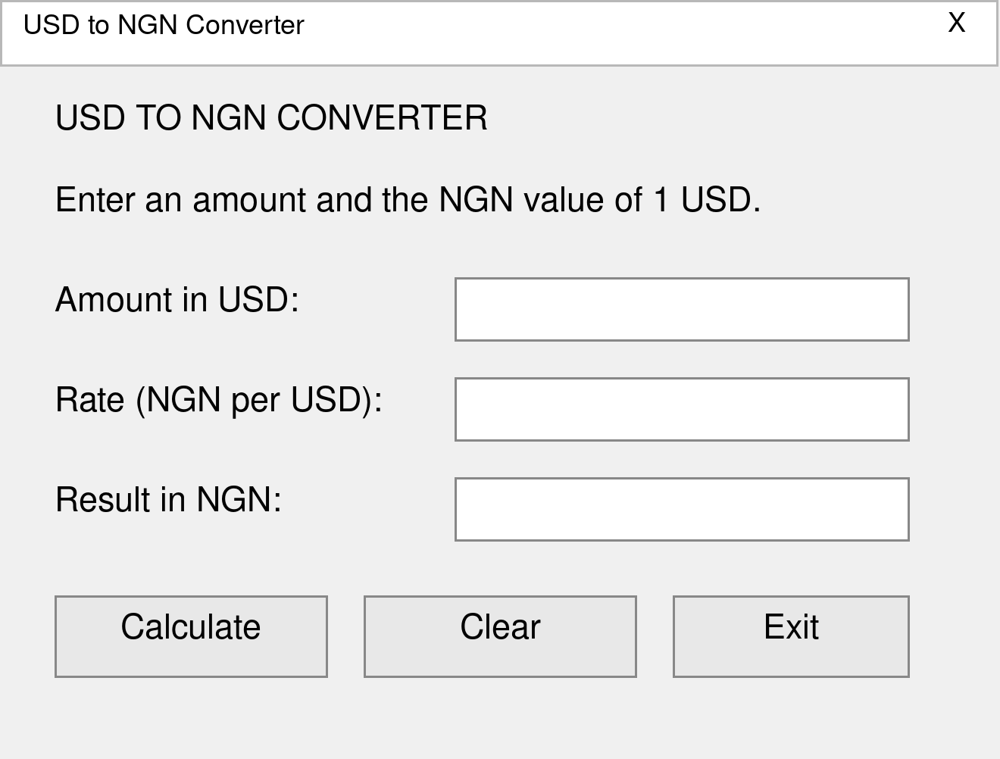
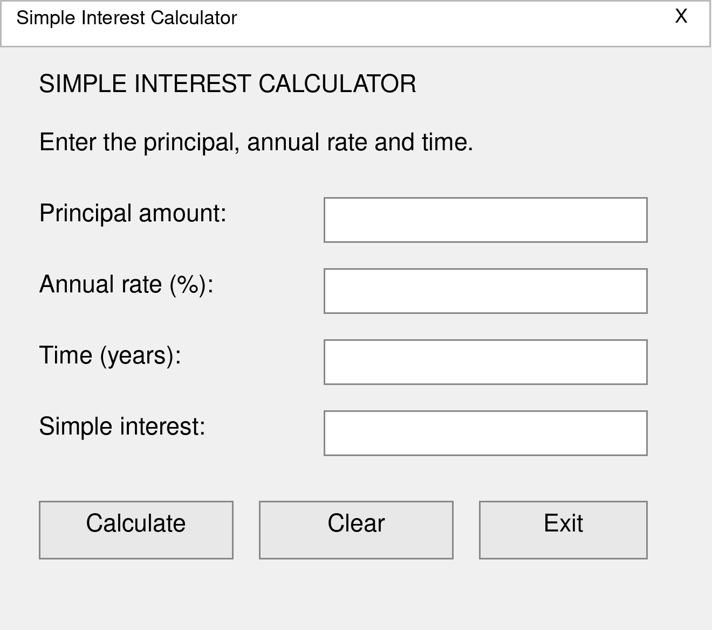
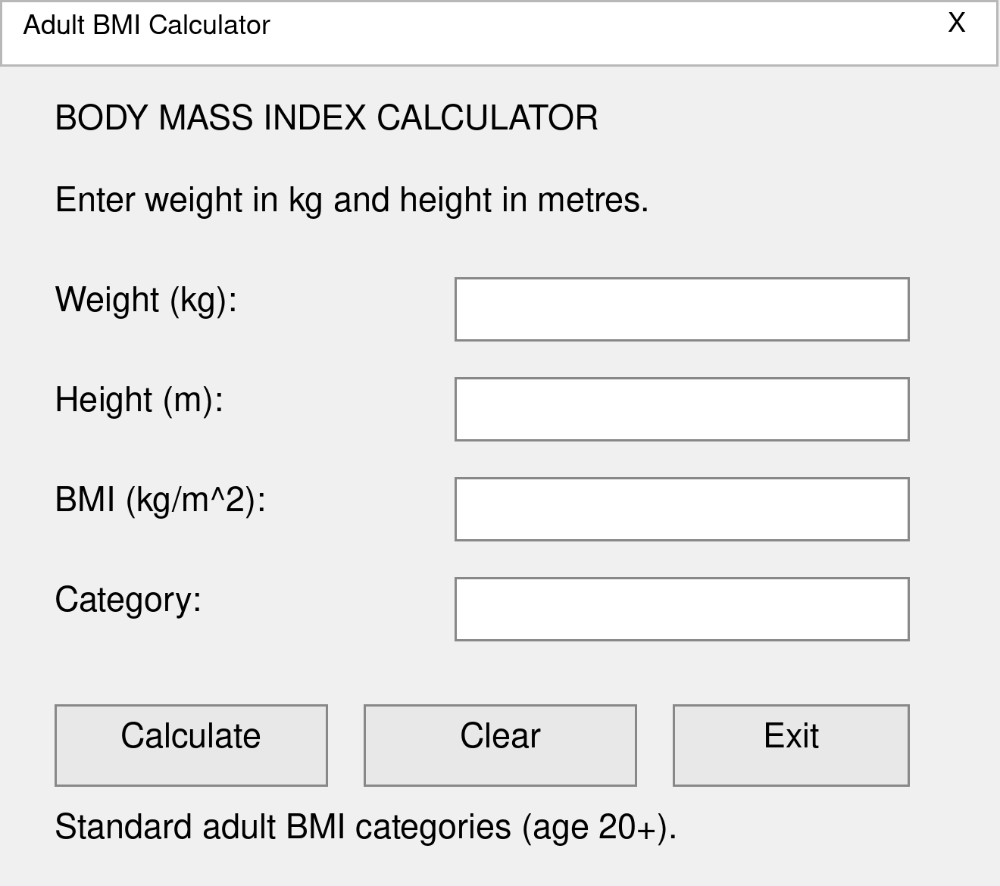
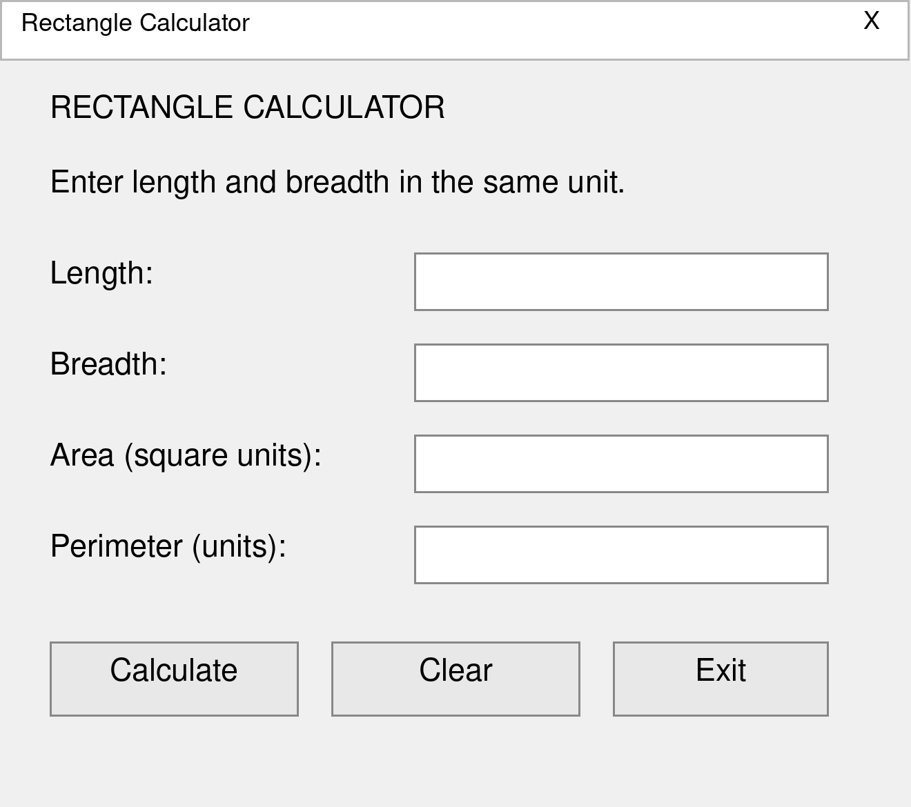

# CIT 104 Visual Basic 6.0 Practical Projects


**National Open University of Nigeria (NOUN) · 2026**

This repository contains four Visual Basic 6.0 practical projects for CIT 104. Each project includes its source code, editable form, compiled executable, form-design screenshot, and practical report.

The exercises cover numerical calculations, user input, validation, event handling, and displaying results through a graphical interface.

## Projects

| Question | Project | Folder | Report |
| --- | --- | --- | --- |
| 1 | USD to NGN Converter | [USD_to_NGN](./USD_to_NGN/) | [View report](./USD_to_NGN/report.docx) |
| 2 | Simple Interest Calculator | [Simple_Interest](./Simple_Interest/) | [View report](./Simple_Interest/report.docx) |
| 3 | Body Mass Index Calculator | [BMI_Calculator](./BMI_Calculator/) | [View report](./BMI_Calculator/report.docx) |
| 4 | Rectangle Area and Perimeter Calculator | [RectangleCalculator](./RectangleCalculator/) | [View report](./RectangleCalculator/report.docx) |

## Getting Started

### Open and edit a project

1. Clone this repository or download it using **Code → Download ZIP**, then extract it.
2. Open the required project folder.
3. Open its `.vbp` file in **Microsoft Visual Basic 6.0**.
4. Press **F5** to run the application.
5. To view the form layout, select the form in Project Explorer and press **Shift + F7**. Press **F7** to view its code.

### Run the compiled application

Open the `.exe` file in the relevant project folder on Windows. The VB6 runtime must be available on the computer.

To rebuild an executable after changing the source, use **File → Make [project name].exe** in VB6.

## Question 1 — USD to NGN Converter

> Write a program that converts an amount in US Dollars (USD) to Nigerian Naira (NGN), given the current exchange rate entered by the user.

The application accepts a USD amount and an exchange rate expressed as **NGN per 1 USD**, then displays the Naira equivalent.

```text
NGN amount = USD amount × Exchange rate
```

**Example:** 10 USD at an illustrative rate of 1,500 NGN per USD gives **15,000.00 NGN**. The user enters the exchange rate manually; the application does not retrieve live rates.

The USD amount must be zero or greater, and the exchange rate must be greater than zero.



[Open project folder](./USD_to_NGN/) · [View form screenshot](./USD_to_NGN/Form_Design.png) · [Download practical report](./USD_to_NGN/report.docx)

## Question 2 — Simple Interest Calculator

> Write a program that calculates the simple interest on a loan given the principal, rate, and time in years. Hint: SI = (Principal × Rate × Time) / 100.

The application accepts the principal, annual percentage rate, and time in years, then displays the interest in the same currency as the principal.

```text
Simple interest = (Principal × Rate × Time) / 100
```

**Example:** A principal of 100,000 at 10% per year for 2 years gives **20,000.00** in interest.

Enter **10** for a 10% annual rate and **0.5** years for six months. Zero values are allowed; negative values are rejected. The result is interest only and excludes the original principal.



[Open project folder](./Simple_Interest/) · [View form screenshot](./Simple_Interest/Form_Design.png) · [Download practical report](./Simple_Interest/report.docx)

## Question 3 — Body Mass Index Calculator

> Write a program that calculates the Body Mass Index (BMI) using weight in kilograms and height in metres. Display whether the user is underweight, normal, overweight, or obese.

The application accepts positive weight and height values, calculates BMI, and displays the corresponding adult category.

```text
BMI = Weight (kg) / [Height (m) × Height (m)]
```

| BMI value | Displayed category |
| --- | --- |
| Below 18.5 | Underweight |
| 18.5 to below 25 | Normal |
| 25 to below 30 | Overweight |
| 30 and above | Obese |

**Example:** A weight of 70 kg and height of 1.75 m give a BMI of **22.86**, classified as **Normal**.

Enter height in metres: **1.75**, rather than **175**, for 175 cm. Classification uses the unrounded BMI; the displayed value is formatted to two decimal places. The project uses standard adult categories for ages 20 and above.

Category reference: [CDC Adult BMI Categories](https://www.cdc.gov/bmi/adult-calculator/bmi-categories.html).



[Open project folder](./BMI_Calculator/) · [View form screenshot](./BMI_Calculator/Form_Design.png) · [Download practical report](./BMI_Calculator/report.docx)

## Question 4 — Rectangle Area and Perimeter Calculator

> Write a program that calculates the area and perimeter of a rectangle given its length and breadth.

The application accepts positive length and breadth values in the same unit and displays both results.

```text
Area = Length × Breadth
Perimeter = 2 × (Length + Breadth)
```

**Example:** A length of 10 m and breadth of 5 m give an area of **50.00 m²** and a perimeter of **30.00 m**.

Area is expressed in square units, while perimeter uses the original unit. The program does not convert between measurement units.



[Open project folder](./RectangleCalculator/) · [View form screenshot](./RectangleCalculator/Form_Design_Rectangle.png) · [Download practical report](./RectangleCalculator/report.docx)

## Shared Features

- **Calculate** performs the calculation and displays the result.
- **Clear** resets the input and output fields.
- **Exit** closes the application.
- Input validation rejects empty, nonnumeric, and out-of-range values.
- Read-only output fields prevent manual changes to results.
- Editing an input clears the previous result.
- Numeric results are displayed to two decimal places.

## Files Included in Each Project

| File | Purpose |
| --- | --- |
| `.vbp` | VB6 project file used to open the application in the IDE. |
| `.frm` | Editable form layout and event-handler code. |
| `.exe` | Compiled Windows application. |
| `Form_Design.png` | Screenshot or visual reference of the form layout. |
| `readme.txt` | Instructions specific to the application. |
| `report.docx` | Practical report covering Problem Statement, Problem Specifications, Analysis, and Design. |

## Verification

To check the applications locally, use the examples in each question, try decimal inputs, and confirm that invalid entries display an error message. For the BMI project, also check the category boundaries at **18.5**, **25**, and **30**. Check the Calculate, Clear, and Exit buttons in every project.

## Academic Context

These projects document the **2026 CIT 104 practical exercises** at the **National Open University of Nigeria**. The source files and reports provide a record of the calculations, interface design, and implementation for each question.